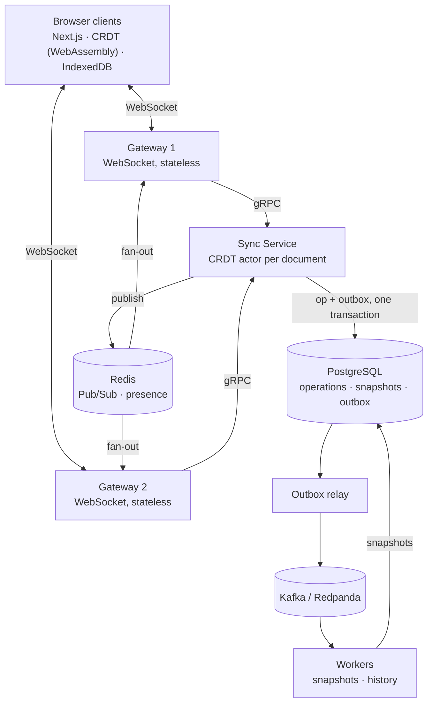

# Collab Engine

[](https://github.com/SrijitGyawali/Collaboration-Engine/actions/workflows/ci.yml)

A distributed real-time collaborative text editor written in Go. Several people edit the same document at once, including while offline, and every copy converges to the same text.

The core is a custom sequence CRDT. Around it, Go services communicate over gRPC, PostgreSQL is the source of truth, Redis fans live edits out across gateway replicas, and Kafka feeds background workers through a transactional outbox.

> **Status:** in active development, November 2026. The table under [Roadmap](#roadmap) shows what works today. Nothing below is claimed until it is built and tested.

## Why this project

Most collaborative-editor demos use a ready-made library such as Yjs. This one implements the merge algorithm itself and proves it with tests:

- concurrent inserts at the same position resolve the same way on every replica
- operations delivered out of order, twice, or after a reconnect still converge
- an acknowledged edit is never lost, even if a gateway crashes

The CRDT's guarantees and API are documented in [internal/crdt](internal/crdt/doc.go), with runnable examples in [example_test.go](internal/crdt/example_test.go). It is tested four ways:

- **Example tests** for specific cases, such as the classic same-position conflict.
- **Property tests:** hundreds of random sessions with 3 to 5 replicas on a network that delays, reorders and repeats messages, checked for convergence, for edits landing where they were made, and against an independent reference model.
- **Fuzz tests** (Go's built-in fuzzer) for malformed operations, fuzzer-chosen editing histories and position edits. These also run in CI on every push.
- **Integration tests** run the services as they are deployed: WebSocket clients, the gateway, real gRPC, the sync service and PostgreSQL. They cover several people editing at once, reconnecting after a dropped connection, and the sync service restarting mid-edit.

## Architecture



**How one edit flows through the system:**

1. The browser applies the edit to its local CRDT immediately and sends it over WebSocket.
2. The gateway forwards it to the sync service with `ApplyOperations` (gRPC).
3. The sync service drops duplicates by `op_id` and applies the edit to that document's CRDT.
4. In one PostgreSQL transaction, it stores the operation with a per-document `seq` and writes an outbox row.
5. The client receives `ack {op_id, seq}` only after that commit.
6. The operation is published to Redis, and every gateway forwards it to its clients.
7. The outbox relay publishes the event to Kafka, where workers build snapshots and history.

If a Redis message is lost, the client notices a gap in `seq` and fetches the missing operations from PostgreSQL.

**What runs today:** the browser, gateway, sync service and PostgreSQL parts work end to end (steps 1 to 5). Every edit also writes its outbox row. For now the gateway broadcasts to its own clients itself; Redis fan-out (step 6) and the Kafka relay and workers (step 7) are weeks 3 and 4.

```text
browser ──WebSocket──▶ gateway ──gRPC──▶ sync service ──▶ PostgreSQL (operations + outbox)
 (CRDT in WebAssembly)  (no state)       (CRDT actor per document)
```

## Tech stack

| Component | Responsibility |
| --- | --- |
| Go | All backend services; one goroutine per connection and per active document |
| Sequence CRDT (RGA-style) | Deterministic merge of concurrent and offline edits |
| WebSocket | Two-way, low-latency link between browser and gateway |
| gRPC + Protocol Buffers | Typed contracts between gateway and sync service |
| PostgreSQL | Durable operations log, snapshots and transactional outbox |
| Redis | Live fan-out across gateways (Pub/Sub) and presence with TTL |
| Kafka (Redpanda locally) | Durable, replayable event stream for background workers |
| Next.js + TypeScript | Editor UI; runs the Go CRDT compiled to WebAssembly |
| Docker Compose | Reproducible local environment |

## Repository layout

```text
cmd/
  gateway/        WebSocket server; sends every edit to sync over gRPC
  sync/           gRPC server around the sync service; PostgreSQL writes
  outbox-relay/   Publishes outbox rows to Kafka
  worker/         Kafka consumers: snapshots, history
  crdt-wasm/      Exposes internal/crdt to the browser as WebAssembly
internal/
  crdt/           The CRDT library (standard library only)
  wire/           JSON / JavaScript form of CRDT ops
  store/          PostgreSQL repositories; memstore (in memory) and storetest (test database)
  pubsub/         Redis Pub/Sub and presence
  events/         Kafka producer and consumers
  gateway/        WebSocket protocol and rooms
  syncsvc/        Sync service: one CRDT actor per document
  syncrpc/        gRPC server and client for the sync service
  platform/       Config, logging, graceful shutdown
proto/            gRPC contract (buf)
gen/              Go code generated from proto/ (make proto)
migrations/       PostgreSQL schema (golang-migrate)
deploy/           Docker Compose: infrastructure and the services
web/              Next.js + TypeScript frontend; runs the Go CRDT as WebAssembly
track/            Daily progress log
```

## Getting started

**Prerequisites:** Go 1.26+, Docker, Make, and Node.js 24+ for the frontend. Code generation tools are pinned and run through Go; nothing else to install.

```bash
git clone https://github.com/SrijitGyawali/Collaboration-Engine.git
cd Collaboration-Engine
cp .env.example .env
make up      # Postgres (15432), Redis (16379), Redpanda (19092) + migrations
make test
make build
```

To run the web app (it loads the Go CRDT as WebAssembly):

```bash
make web-install
make web-dev   # http://localhost:3000
```

Then open http://localhost:3000/editor in two tabs and type in both: edits merge through the CRDT, between tabs of one browser.

### Run the whole system

```bash
make stack                              # infrastructure, migrations, sync service, gateway
cp web/.env.example web/.env.local      # point the editor at ws://localhost:8080/ws
make web-dev
```

Open http://localhost:3000/editor in two different browsers. Edits go through the gateway and the sync service into PostgreSQL. If the gateway is stopped, the editor keeps your edits and sends them when it reconnects.

Run `make help` to list every target:

| Target | What it does |
| --- | --- |
| `make up` / `make down` | Start or stop local infrastructure |
| `make stack` | Build and start everything, including the sync service and gateway |
| `make reset` | Stop infrastructure and delete its data |
| `make migrate` | Apply database migrations |
| `make build` | Build all services into `bin/` |
| `make wasm` | Build the CRDT WebAssembly module |
| `make web-wasm` | Build the module and copy it, with Go's `wasm_exec.js`, into `web/public` |
| `make web-install` | Install the web app's npm dependencies |
| `make web-dev` | Rebuild the module and start the web dev server |
| `make web-test` | Rebuild the module and run the web tests |
| `make test` | Run Go tests (the data layer's tests use a real Postgres through Docker) |
| `make test-short` | Run only the Go tests that need no Docker |
| `make cover` | Run tests with coverage and print the total |
| `make bench` | Run benchmarks |
| `make fuzz` | Fuzz the CRDT (`FUZZTIME=30s` per target by default) |
| `make lint` / `make fmt` | Lint or format Go code |
| `make proto` / `make proto-check` | Generate gRPC code / check it matches the contract |

## Key design decisions

| Decision | Reason |
| --- | --- |
| CRDT rather than Operational Transformation | No central transform logic; works offline; convergence is testable |
| Custom CRDT rather than Yjs | The merge algorithm is the core of the project |
| PostgreSQL as the source of truth | Transactions and queryable history; Redis and Kafka only carry copies |
| Transactional outbox | Prevents the database and Kafka from disagreeing (the dual-write problem) |
| Redis for live fan-out, Kafka for background work | Redis is fast but lossy; Kafka is durable and replayable |
| Ack only after commit | The client is never told an edit is saved when it is not |
| Restore creates a new revision | History is never destroyed |

## Roadmap

| Week | Goal | Status |
| --- | --- | --- |
| 0 | Repository, tooling, CI | Done |
| 1 | CRDT core with property tests; WebAssembly build | Done: CRDT with property and fuzz tests, running in the browser; shared editor syncing between tabs |
| 2 | WebSocket + PostgreSQL; split into services over gRPC | Done: data layer, WebSocket gateway, sync service over gRPC, browser editing through the server, Compose stack, and integration tests through every layer |
| 3 | Redis fan-out, presence, offline editing, failure tests | Not started |
| 4 | Outbox + Kafka workers, metrics, load test, demo | Not started |

Day-by-day notes are in [track/](track/README.md).

### CRDT benchmarks so far

Measured on an Intel i7-1165G7 laptop with a 10,000-character document. Run them yourself with `make bench`.

| Operation | Cost |
| --- | --- |
| Type a character at the end | about 0.5 µs |
| Type a character in the middle | about 6 to 15 µs |
| Apply 10,000 remote ops in order | about 4 to 5 ms |
| Render the full text | about 0.12 ms |

End-to-end latency and throughput will be published here once the load tests run.
